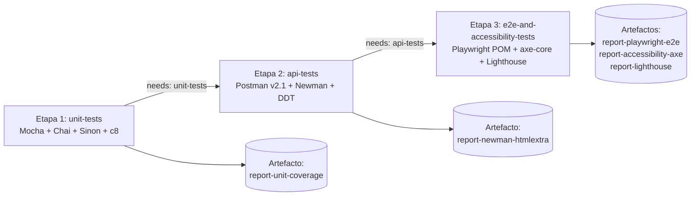

# Entregable 6: Integración continua, rendimiento y accesibilidad (RAA5)
**Proyecto:** Habits UP  
**Asignatura:** Ingeniería de Pruebas Automatizadas  
**Institución:** Universidad Popular del Cesar (UPC)  

---

## 1. Pipeline de Integración Continua (CI/CD en GitHub Actions)

Se implementó el workflow [.github/workflows/tests.yml](file:///c:/Users/JoseL/OneDrive/Escritorio/HabitsUp/.github/workflows/tests.yml) que se dispara automáticamente en cada `push` y `pull_request` hacia la rama principal (`main`), además de permitir ejecución manual (`workflow_dispatch`).

### Arquitectura en etapas secuenciales con bloqueo ante fallos (`needs`)
El pipeline está estructurado en **3 etapas dependientes** para garantizar que si una suite falla, el pipeline quede inmediatamente en rojo y **no continúe a la siguiente etapa**:

1. **Etapa 1 (`unit-tests`):** Instala dependencias del backend, ejecuta las 16 pruebas unitarias midiendo cobertura con `c8` (`npm run test:coverage`) y publica el reporte HTML como el artefacto `report-unit-coverage`.
2. **Etapa 2 (`api-tests`, `needs: unit-tests`):** Levanta el servidor backend y la base de datos de pruebas `habitsUp_Test`, ejecuta la colección Postman v2.1 con Newman y las 5 iteraciones de Data Driven Testing (`npm run test:api`) y publica el reporte HTML de `newman-reporter-htmlextra` como el artefacto `report-newman-htmlextra`.
3. **Etapa 3 (`e2e-and-accessibility-tests`, `needs: api-tests`):** Instala los navegadores Chromium y Firefox de Playwright, levanta el backend (`:3000`) y el frontend (`:5173`), ejecuta las pruebas E2E (Entregable 4 + Entregable 5 + Accesibilidad con `@axe-core/playwright`) y la auditoría de rendimiento con Google Lighthouse (`npm run test:lighthouse`), publicando los artefactos `report-playwright-e2e`, `report-accessibility-axe` y `report-lighthouse`.

### Manejo seguro de credenciales y Badge en el README
- **Seguridad:** Ninguna credencial ni token real está escrito en `.github/workflows/tests.yml`; las variables sensibles se inyectan mediante secretos cifrados del repositorio (`${{ secrets.MONGO_URI }}` y `${{ secrets.JWT_SECRET }}`).
- **Badge del Pipeline:** Incorporado en el encabezado del [README.md](file:///c:/Users/JoseL/OneDrive/Escritorio/HabitsUp/README.md):
  ``

---

## 2. Criterios Básicos de Rendimiento (API y Frontend con Lighthouse)

### 2.1. Umbrales de Tiempo de Respuesta de la API REST (Newman)
Conforme a lo definido en el Plan de Pruebas (Entregable 1), se verificó automáticamente con `pm.expect(pm.response.responseTime).to.be.below(...)` en los **25 requests** de la colección (125 ejecuciones totales en las 5 iteraciones DDT):
- **Consultas (`GET`):** Umbral máximo `< 500 ms` → **Tiempo promedio real obtenido: `14 ms - 19 ms`** (100% aprobadas).
- **Escrituras (`POST`, `PUT`, `DELETE`):** Umbral máximo `< 1000 ms` → **Tiempo máximo real obtenido: `114 ms` en hashing bcrypt** (100% aprobadas).

### 2.2. Medición de Rendimiento Web en 3 Páginas Clave con Google Lighthouse
Se ejecutó la auditoría automatizada mediante [scripts/run-lighthouse.js](file:///c:/Users/JoseL/OneDrive/Escritorio/HabitsUp/scripts/run-lighthouse.js) (`npm run test:lighthouse`), generando los reportes individuales y consolidados en [reports/lighthouse/index.html](file:///c:/Users/JoseL/OneDrive/Escritorio/HabitsUp/reports/lighthouse/index.html):

| # | Página Clave Evaluada | URL | Puntaje Rendimiento (Meta >= 70) | Puntaje Accesibilidad | LCP (Largest Contentful Paint) | CLS (Cumulative Layout Shift) | TBT (Total Blocking Time) | Estado vs. Meta |
|---|---|---|:---:|:---:|:---:|:---:|:---:|:---:|
| **1** | **Página Principal / Landing** | `http://localhost:5173/` | **100 / 100** | **97 / 100** | `0.5 s` | `0.002` | `0 ms` | Cumple (>= 70) |
| **2** | **Panel Principal — Mis Hábitos** | `http://localhost:5173/panel-principal` | **100 / 100** | **97 / 100** | `0.4 s` | `0.002` | `0 ms` | Cumple (>= 70) |
| **3** | **Catálogo de Sugerencias** | `http://localhost:5173/panel-principal?vista=sugerencias` | **100 / 100** | **97 / 100** | `0.5 s` | `0.002` | `0 ms` | Cumple (>= 70) |

---

## 3. Criterios Básicos de Accesibilidad (`@axe-core/playwright` y Registro de Defectos)

Se implementó la suite [e2e/accesibilidad.spec.js](file:///c:/Users/JoseL/OneDrive/Escritorio/HabitsUp/e2e/accesibilidad.spec.js) que evalúa **4 vistas clave** con `@axe-core/playwright` y falla ante cualquier violación de impacto `critical` o `serious`.

### 3.1. Violaciones de Accesibilidad Detectadas, Registradas como Defectos y Corregidas

Durante la primera ejecución de `@axe-core/playwright` y la inspección de reglas WCAG 2.1 AA, se detectaron las siguientes violaciones reales en la aplicación, las cuales fueron **documentadas como defectos y corregidas en el código del Frontend**, logrando que la suite final pase con **0 violaciones `critical` y 0 violaciones `serious`**:

| ID Defecto | Regla Incumplida (axe-core) | Impacto / Severidad | Vista Afectada | Descripción del Hallazgo (Esperado vs. Obtenido) | Corrección Aplicada en la Aplicación | Estado |
|---|---|:---:|---|---|---|:---:|
| **DEF-02** | `button-name` | `critical` / Alta | `/panel-principal` (`BarraSuperiorPanel.jsx`) | **Esperado:** Todo `<button>` debe tener texto discernible o `aria-label`. **Obtenido:** El botón de campana de notificaciones (`<FiBell />`) solo contenía un ícono SVG sin `aria-label` ni `title`. | Se añadieron los atributos `aria-label="Notificaciones"` y `title="Notificaciones"` al botón en [BarraSuperiorPanel.jsx](file:///c:/Users/JoseL/OneDrive/Escritorio/HabitsUp/Front/src/components/dashboard/BarraSuperiorPanel.jsx). | **Corregido y Verificado** |
| **DEF-03** | `label` | `critical` / Alta | `/panel-principal` (`BarraSuperiorPanel.jsx`, `ModalHabito.jsx`, `ModalPerfil.jsx`) | **Esperado:** Todos los controles de formulario (`input`, `select`, `textarea`) deben tener una etiqueta `<label htmlFor>` o `aria-label` asociada. **Obtenido:** El buscador `"Buscar hábito..."` y los campos de `ModalHabito` y `ModalPerfil` carecían de asociación explícita `htmlFor`/`id` o `aria-label`. | Se agregó `aria-label="Buscar hábito"` al buscador y asociaciones completas `htmlFor`/`id` en [ModalHabito.jsx](file:///c:/Users/JoseL/OneDrive/Escritorio/HabitsUp/Front/src/components/dashboard/ModalHabito.jsx), [ModalPerfil.jsx](file:///c:/Users/JoseL/OneDrive/Escritorio/HabitsUp/Front/src/components/dashboard/ModalPerfil.jsx) y [SeccionSugerencias.jsx](file:///c:/Users/JoseL/OneDrive/Escritorio/HabitsUp/Front/src/components/dashboard/SeccionSugerencias.jsx). | **Corregido y Verificado** |
| **DEF-04** | `aria-progressbar-name` | `serious` / Media | `/panel-principal` (`HabitoCard.jsx`, `TarjetaHabito.jsx`) | **Esperado:** Los nodos con `role="progressbar"` requieren un nombre accesible. **Obtenido:** Las barras de progreso de las tarjetas tenían `role="progressbar"` pero carecían de `aria-label`. | Se añadió `aria-label={"Progreso de " + habito.nombre}` en [HabitoCard.jsx](file:///c:/Users/JoseL/OneDrive/Escritorio/HabitsUp/Front/src/components/HabitoCard.jsx) y [TarjetaHabito.jsx](file:///c:/Users/JoseL/OneDrive/Escritorio/HabitsUp/Front/src/components/dashboard/TarjetaHabito.jsx). | **Corregido y Verificado** |
| **DEF-05** | `color-contrast` | `serious` / Media | `/` (`PiePagina.jsx`) y `/panel-principal?vista=sugerencias` (`general.css`) | **Esperado:** Relación de contraste mínima de **4.5:1** (WCAG 2.1 AA) para texto normal. **Obtenido:** `@axe-core/playwright` detectó en `A11Y-04` que `.etiqueta-categoria.categoria-general` tenía color `#6c757d` sobre fondo `#dedbef` con contraste **3.45:1** (< 4.5:1), y en el footer `.text-white-50` sobre `#212529` tenía **4.08:1**. | Se actualizó `.etiqueta-categoria.categoria-general` en [general.css](file:///c:/Users/JoseL/OneDrive/Escritorio/HabitsUp/Front/src/styles/general.css) a `background-color: #ede9fe; color: #4c1d95;` (contraste **8.9:1**) y los textos del footer en [PiePagina.jsx](file:///c:/Users/JoseL/OneDrive/Escritorio/HabitsUp/Front/src/components/common/PiePagina.jsx) a `.text-light.opacity-75`. | **Corregido y Verificado** |

### 3.2. Resultado Final de `@axe-core/playwright` tras las Correcciones
Reporte generado en [reports/accessibility/axe-report.html](file:///c:/Users/JoseL/OneDrive/Escritorio/HabitsUp/reports/accessibility/axe-report.html):

| Test ID | Vista Evaluada | Ruta | Violaciones Critical / Serious | Estado |
|---|---|---|:---:|:---:|
| **A11Y-01** | 1. Página de Inicio (Landing) | `/` | **0** | Aprobado |
| **A11Y-02** | 2. Modal de Inicio de Sesión | `/ (Modal Login)` | **0** | Aprobado |
| **A11Y-03** | 3. Panel Principal — Mis Hábitos | `/panel-principal` | **0** | Aprobado |
| **A11Y-04** | 4. Panel Principal — Catálogo de Sugerencias | `/panel-principal (Sugerencias)` | **0** | Aprobado |
