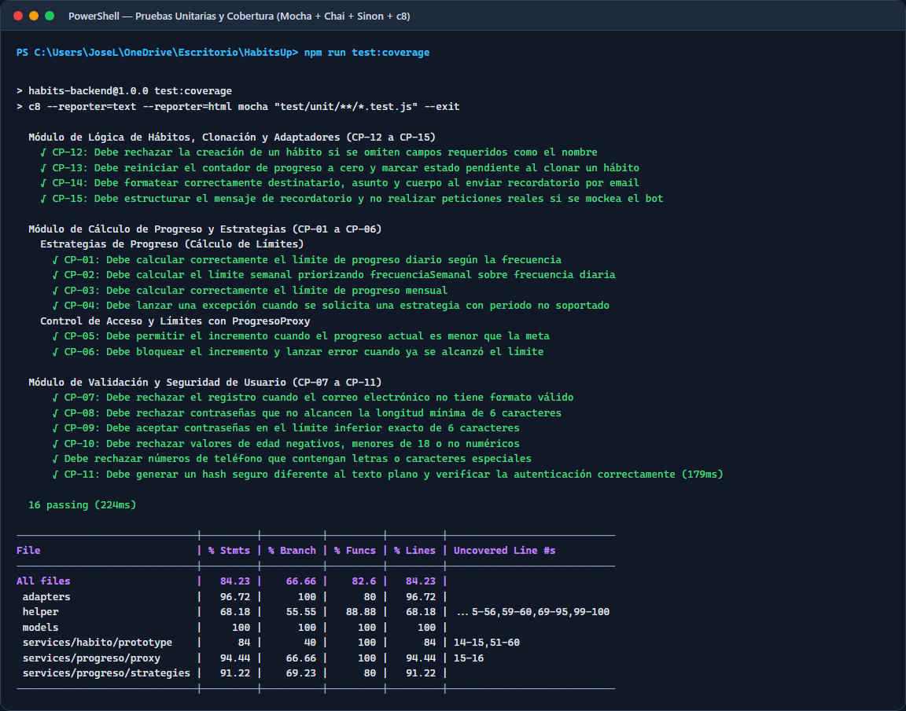
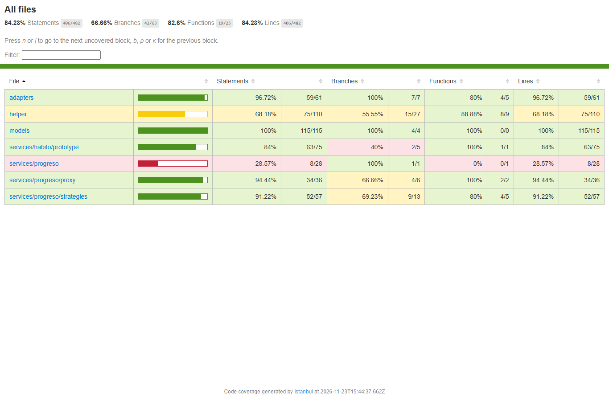
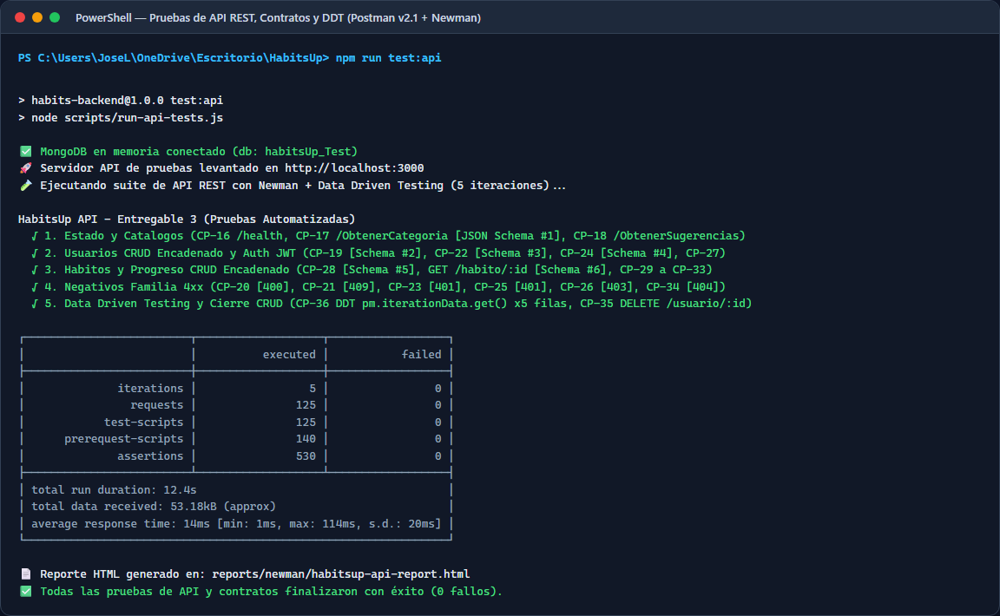
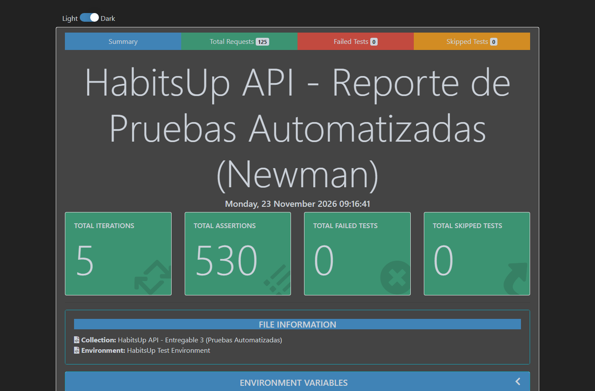
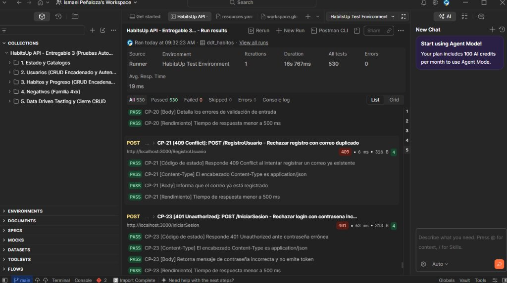
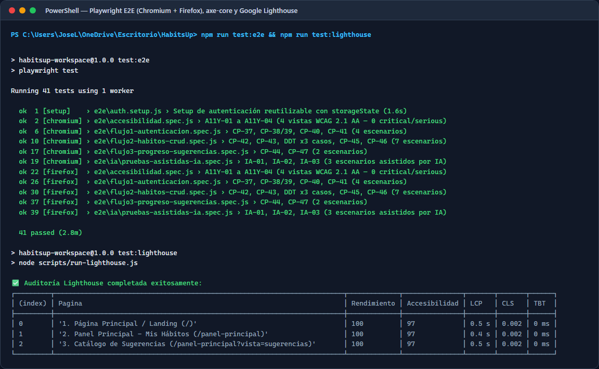
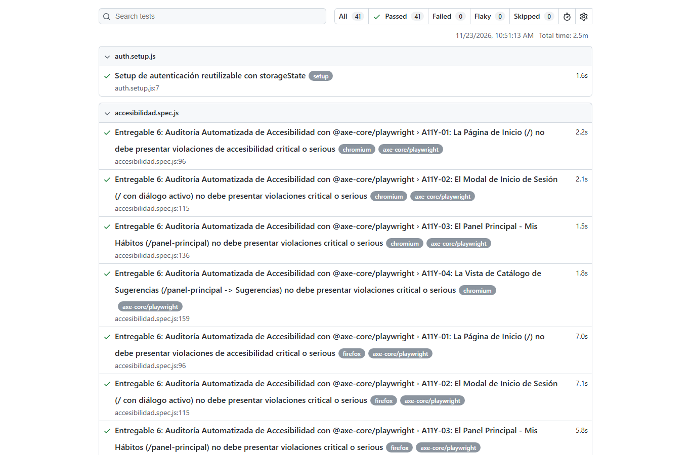
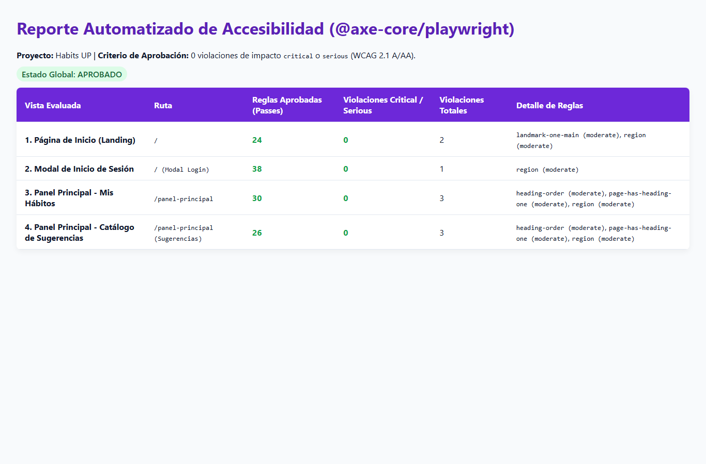
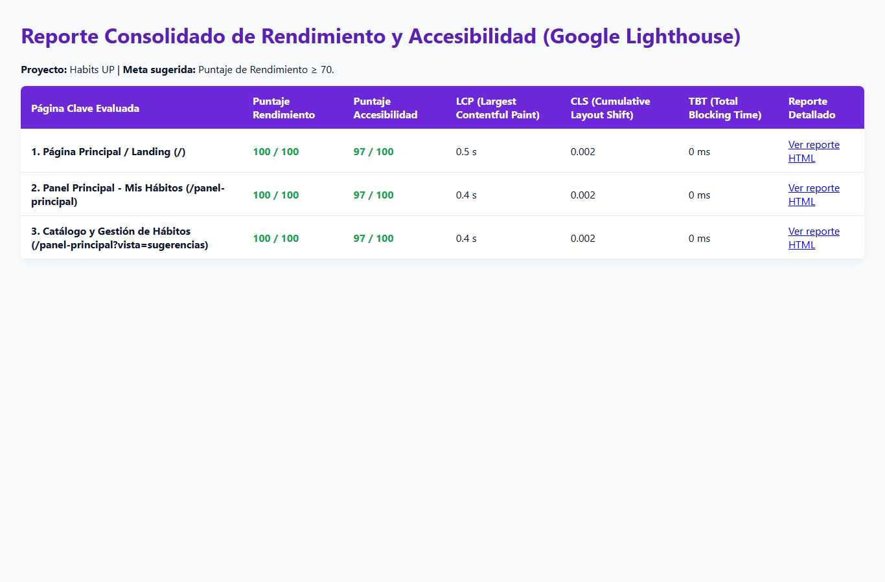
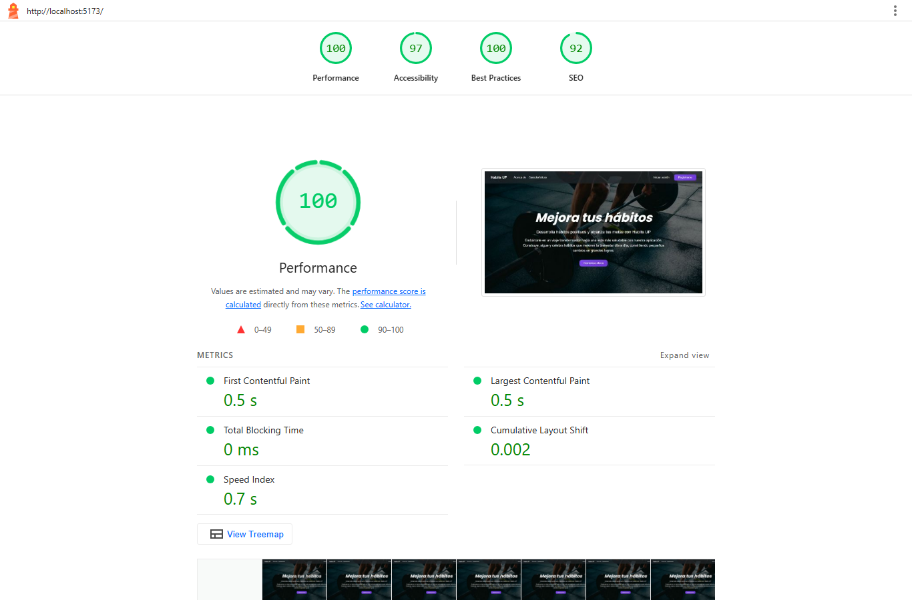

# INFORME FINAL — PROYECTO DE PRUEBAS AUTOMATIZADAS: HABITS UP

---

## 1. Portada

- **Institución:** Universidad Popular del Cesar (UPC)
- **Programa:** Ingeniería de Sistemas — Electiva Profesional
- **Asignatura:** Ingeniería de Pruebas Automatizadas
- **Docente:** Ing. Esp. Amilkar Hernandez
- **Nombre del Proyecto Web:** Habits UP (Plataforma de Gestión y Seguimiento de Hábitos)
- **Integrantes:**
  1. Jose Alfredo Maestre Manjarrez
  2. Ismael Jose Peñaloza Ortiz
- **Stack Tecnológico:**
  - **Frontend:** React 19, Vite 8, React Router DOM 7, Axios 1.13, Bootstrap 5.3
  - **Backend:** Node.js 20+ LTS, Express 5.2, Mongoose 8.23, bcrypt 6.0, JWT HS256
  - **Base de Datos:** MongoDB (Atlas / `mongodb-memory-server` `habitsUp_Test` para ejecución aislada en CI y clon limpio)
- **URL del Repositorio:** https://github.com/JAlfredoSoc/HabitsUp
- **Pipeline CI/CD:** https://github.com/JAlfredoSoc/HabitsUp/actions/workflows/tests.yml
- **Fecha de Entrega:** Noviembre de 2026

---

## 2. Resumen Ejecutivo

El presente informe documenta el diseño, automatización, ejecución y reporte integral de pruebas de software para la aplicación web **Habits UP**, aplicando la estrategia de la **Pirámide de Pruebas** en todos sus niveles (Unitarias, API REST, End-to-End, Accesibilidad y Rendimiento) e integrando la ejecución continua mediante **GitHub Actions**.

- **Cobertura funcional y cuantitativa lograda:**
  - **Pruebas Unitarias (`Mocha` + `Chai` + `Sinon` + `c8`):** **16 pruebas** sobre 3 módulos de lógica de negocio (`Progreso`, `ValidacionesUsuario` y `Hábitos/Adaptadores`), con **16/16 aprobadas (100%)** y una cobertura global real del **84.23% de líneas** (superando ampliamente la meta mínima del 75%).
  - **Pruebas de API REST (`Postman v2.1` + `Newman` + `htmlextra`):** Colección de **25 requests** organizados en 5 carpetas (CRUD encadenado de Usuarios y Hábitos, autenticación JWT automatizada con Pre-request global, **6 contratos JSON Schema**, **6 escenarios negativos 4xx** con códigos `400`, `401`, `403`, `404` y `409`, y **Data Driven Testing** de 5 filas con `pm.iterationData.get()`), ejecutando **125 requests y 530 aserciones** con **0 fallos (100%)** y un tiempo promedio de respuesta de **`14 ms`**.
  - **Pruebas End-to-End (`Playwright` + Page Object Model + Asistidas por IA):** **16 escenarios E2E** (13 de los 3 flujos críticos incluyendo 4 negativos y 3 casos DDT + **3 escenarios adicionales generados y revisados con Playwright MCP** en `e2e/ia/`) más **4 auditorías de accesibilidad (`@axe-core/playwright`)**, ejecutados sobre **2 navegadores (`Chromium` y `Firefox`)** con **41/41 ejecuciones aprobadas (100%)** usando 6 Page Objects inyectados con `test.extend` y autenticación reutilizable por `storageState`.
  - **Rendimiento y Accesibilidad Web (`Google Lighthouse`):** Puntaje de **100/100 en Rendimiento** y **97/100 en Accesibilidad** en las 3 páginas clave evaluadas (`LCP` entre `0.4 s` y `0.5 s`, `CLS: 0.002`, `TBT: 0 ms`).
- **Principales hallazgos:** La automatización permitió detectar **5 defectos reales** en la aplicación (**1 defecto funcional/CSS crítico** en el botón `"Nuevo hábito"` y **4 violaciones WCAG 2.1 AA de accesibilidad**), todos ellos registrados, corregidos en el código fuente y verificados en verde con las mismas pruebas.

---

## 3. Descripción del Sistema

### Propósito
**Habits UP** es una aplicación web orientada a mejorar la constancia personal mediante la creación, organización, edición, clonación y seguimiento cuantificable de hábitos diarios, semanales y mensuales, complementada con un catálogo de categorías, hábitos sugeridos, gestión de perfil de usuario, historial y estadísticas de cumplimiento.

### Arquitectura Cliente-Servidor
```text
[ Navegador Web (Chromium / Firefox) ]
          │
          ▼ (HTTP / JSON — Axios)
[ Frontend SPA (React 19 + Vite 8 + Bootstrap 5) ]
          │  ├── EnrutadorPrincipal con RutaProtegida (/ y /panel-principal)
          │  ├── Modales: Login, Registro, Hábito y Perfil
          │  └── Fábrica de Tarjetas (HabitoUIFactory / Factory Selector)
          ▼ (REST API + CORS + Bearer JWT)
[ API REST Backend (Node.js 20 + Express 5) ]
          │  ├── Rutas y Controladores (Usuario, Hábito, Progreso, Historial, Sugerencias)
          │  ├── Patrones de Diseño: Strategy + Bridge + Proxy (Progreso), Builder + Director + Prototype (Hábitos), Flyweight (Categorías), Adapter (Notificaciones)
          │  └── Helpers: ValidacionesUsuario (bcrypt) y JwtHelper (HMAC-SHA256)
          ▼ (ODM Mongoose 8)
[ MongoDB (Atlas / MongoMemoryServer habitsUp_Test) ]
```

### Alcance del Proyecto de Pruebas
- **Módulos dentro del alcance:** Registro, validación de datos, cifrado `bcrypt`, autenticación JWT, perfil de usuario, guardia de rutas SPA, catálogo de categorías y sugerencias, CRUD completo de hábitos, incremento y límite de progreso, clonación con *Prototype*, historial de acciones, estadísticas, accesibilidad WCAG 2.1 AA y rendimiento frontend/backend.
- **Módulos fuera del alcance directo (aislados con dobles/mocks):** Envío real de correos electrónicos SMTP (`nodemailer`), bot real de Telegram (`node-telegram-bot-api`) y cron jobs programados en segundo plano (`node-cron`), aislados mediante stubs de `Sinon` para evitar efectos secundarios externos.

---

## 4. Estrategia y Plan de Pruebas (Entregable 1)

### Pirámide de Pruebas Real del Proyecto

```text
               /\
              /  \       E2E + IA + A11Y (Playwright): 20 pruebas x 2 navegadores + setup = 41 ejecuciones
             /----\
            /      \     Integración & API (Postman/Newman): 25 requests x 5 iteraciones DDT = 125 requests / 530 asserts
           /--------\
          /          \   Pruebas Unitarias (Mocha + Chai + Sinon): 16 pruebas aisladas (84.23% cobertura de líneas)
         --------------
```

### Roles de Calidad en el Equipo
| Integrante | Responsabilidades de Calidad y SDLC |
|---|---|
| **Jose Alfredo Maestre Manjarrez** | Diseño del plan de pruebas, automatización de pruebas unitarias (Mocha/Chai/Sinon), medición de cobertura (`c8`), revisión cruzada de pruebas API y cierre de defectos de backend. |
| **Ismael Jose Peñaloza Ortiz** | Automatización de pruebas API REST (Postman/Newman/DDT), pruebas E2E con Playwright (POM) y asistidas por IA (Playwright MCP), revisión cruzada de unitarias y cierre de defectos de UI. |
| **Equipo Conjunto** | Configuración del pipeline CI/CD en GitHub Actions, auditorías Lighthouse y `@axe-core/playwright`, registro de defectos, consolidación del informe final y sustentación. |

### Matriz de Riesgos Priorizados
| ID Riesgo | Descripción del Riesgo | Probabilidad | Impacto | Estrategia de Mitigación Aplicada |
|---|---|:---:|:---:|---|
| **R-01** | Exposición de contraseñas o acceso no autorizado a perfiles ajenos | Media | Crítico | Validación de hash `bcrypt`, ausencia de campo `contrasena` en JSON Schema y tests negativos `401`/`403` en API + guardia de ruta `CP-41` en SPA. |
| **R-02** | Inconsistencia al superar el límite de progreso o perder historial al editar | Media | Alto | Pruebas unitarias sobre `ProgresoProxy` (`CP-05`, `CP-06`), pruebas API (`CP-30`, `CP-32`) y persistencia E2E tras recarga (`CP-44`). |
| **R-03** | Bloqueos de interfaz por estilos CSS o regresiones entre navegadores | Alta | Alto | Ejecución E2E automatizada en **2 navegadores** (`Chromium` y `Firefox`), lo cual detectó y permitió corregir `DEF-01`. |
| **R-04** | Barreras de accesibilidad (contraste, etiquetas faltantes) | Media | Medio | Auditoría automática bloqueante con `@axe-core/playwright` (`0` violaciones `critical`/`serious`) y Google Lighthouse. |
| **R-05** | Dependencia de base de datos externa o credenciales en el repositorio | Alta | Alto | Base de datos en memoria `habitsUp_Test` con sembrado automático (`seed.js`) y manejo de secretos exclusivamente en GitHub Secrets. |

### Entornos, Datos Semilla y Limpieza
- **Levantamiento local:** Backend en `http://localhost:3000` (`node Back/src/server.js`) y Frontend en `http://localhost:5173` (`npm --prefix Front run dev`).
- **Datos semilla automáticos ([seed.js](file:///c:/Users/JoseL/OneDrive/Escritorio/HabitsUp/Back/src/config/seed.js)):** 6 categorías (`Salud`, `Bienestar`, `Estudio`, `Productividad`, `Trabajo`, `Relaciones`) y 3 sugerencias base (`Beber 2L de agua`, `Lectura diaria`, `Meditación`).
- **Política de aislamiento y limpieza:** Todos los usuarios de prueba usan correos dinámicos únicos con timestamp bajo `@example.test`. En API, `CP-35` (`DELETE /usuario/:id`) elimina en cascada el usuario y todos sus datos al finalizar cada iteración; en pruebas aisladas se utiliza la base efímera `habitsUp_Test`.

---

## 5. Diseño de Casos de Prueba y Trazabilidad

Se diseñaron y automatizaron **54 escenarios trazables** distribuidos en todos los niveles (la matriz completa detallada se encuentra en el **Anexo A**):

| Nivel de Prueba | Rango de IDs | Escenarios Diseñados | Ejecuciones Automatizadas | Herramienta |
|---|---|:---:|:---:|---|
| **Pruebas Unitarias** | `CP-01` a `CP-15` (+ validación extra teléfono) | 16 casos | 16 pruebas | Mocha + Chai + Sinon + c8 |
| **Pruebas de API REST y DDT** | `CP-16` a `CP-36` (+ consultas complementarias) | 25 requests | 125 requests (530 asserts) | Postman v2.1 + Newman |
| **Pruebas E2E (POM)** | `CP-37` a `CP-47` (+ 3 casos DDT) | 13 escenarios | 26 ejecuciones + 1 setup | Playwright (Chromium + Firefox) |
| **Pruebas E2E Asistidas por IA** | `IA-01` a `IA-03` | 3 escenarios | 6 ejecuciones | Playwright MCP + POM |
| **Accesibilidad y Rendimiento** | `A11Y-01` a `A11Y-04` + 3 páginas Lighthouse | 7 auditorías | 8 ejecuciones axe + 3 Lighthouse | `@axe-core/playwright` + Lighthouse |

---

## 6. Pruebas Unitarias, Mocking, TDD y Cobertura (Entregable 2)

### Framework, Módulos Probados y Uso de Mocks
- **Stack unitario:** `Mocha 12`, `Chai 6`, `Sinon 22` (stubs y spies) y `c8 12` (cobertura de código con reporte HTML).
- **Módulos de lógica de negocio evaluados:**
  1. **Estrategias de Progreso y Control de Acceso** (`ProgresoDiario`, `ProgresoSemanal`, `ProgresoMensual`, `ProgresoBridge`, `ProgresoProxy`) en [progreso.test.js](file:///c:/Users/JoseL/OneDrive/Escritorio/HabitsUp/Back/test/unit/services/progreso.test.js).
  2. **Validación y Seguridad de Usuario** (`ValidacionesUsuario` con email, contraseña límite 5 vs 6 caracteres, edad, teléfono y hashing `bcrypt`) en [usuarioValidacion.test.js](file:///c:/Users/JoseL/OneDrive/Escritorio/HabitsUp/Back/test/unit/services/usuarioValidacion.test.js).
  3. **Lógica de Hábitos, Clonación y Adaptadores** (`Habito`, `HabitoPrototype`, `EmailAdapter`, `TelegramAdapter`) en [habitoNotificacion.test.js](file:///c:/Users/JoseL/OneDrive/Escritorio/HabitsUp/Back/test/unit/services/habitoNotificacion.test.js).

### Ejemplo de Prueba Unitaria con Bloques AAA y Dobles de Prueba (`Sinon`)
```javascript
// CP-06: Bloquear incremento cuando el límite fue alcanzado (ProgresoProxy + Stub + Spy)
it("CP-06: Debe bloquear el incremento y lanzar error cuando ya se alcanzó el límite", async () => {
  // Arrange
  const proxy = new ProgresoProxy();
  const mockProgreso = { habito: "habito123", periodo: "diario", frecuencia: 3, progreso: 3 };
  sinon.stub(Progreso, "findOne").resolves(mockProgreso);
  const serviceSpy = sinon.spy(proxy.service, "actualizar");

  // Act & Assert
  try {
    await proxy.actualizar("habito123", "usuario001");
    expect.fail("Debería haber lanzado un error");
  } catch (error) {
    expect(error.message).to.equal("El hábito ya está completado");
    expect(serviceSpy.called).to.be.false;
  }
});
```

### Cobertura Real Obtenida (`c8`) y Evidencia del Ciclo de Commits
- **Cobertura Global sobre los módulos probados:** **`84.23%` de Líneas** | **`84.23%` de Sentencias** | **`82.60%` de Funciones** | **`66.66%` de Ramas** (meta mínima: `75%` de líneas — **Cumplida**).
- **Trazabilidad de commits del ciclo unitario y refactorización:**
  - `9979575` — *Entregable 2 Pruebas unitarias* (definición de suite unitaria sobre progreso, validaciones y adaptadores)
  - `0b83141` — *Entregable 2 Medicion cobertura* (configuración de `c8` y reporte HTML de cobertura)
  - `4423a6b` — *Arreglos* (refactorización de `ValidacionesUsuario` y controladores de registro/edición con pruebas en verde)





---

## 7. Pruebas de API REST con Postman y Newman (Entregable 3)

### Estructura de Colección v2.1, Autenticación y Contratos
- **Colección:** [HabitsUp.postman_collection.json](file:///c:/Users/JoseL/OneDrive/Escritorio/HabitsUp/Back/postman/HabitsUp.postman_collection.json) (formato oficial **v2.1.0**, 5 carpetas, **25 requests**).
- **Environment sin credenciales reales:** [HabitsUp.postman_environment.json](file:///c:/Users/JoseL/OneDrive/Escritorio/HabitsUp/Back/postman/HabitsUp.postman_environment.json).
- **Autenticación automatizada:** `CP-22` (`POST /IniciarSesion`) captura el token JWT (`body.token`) en `authToken`, y un **Pre-request Script a nivel de colección** inyecta automáticamente `Authorization: Bearer <token>` en cada petición.
- **CRUD completo encadenado de 2 recursos:**
  - **Recurso 1 (`Usuarios`):** `POST /RegistroUsuario` (guarda `usuarioId`) → `POST /IniciarSesion` (guarda `authToken`) → `GET /usuario/{{usuarioId}}` → `PUT /EditarUsuario/{{usuarioId}}` → `DELETE /usuario/{{usuarioId}}` (cascada).
  - **Recurso 2 (`Hábitos`):** `POST /CrearHabitos` (guarda `habitoId`) → `GET /habito/{{habitoId}}` → `GET /ObtenerHabitos/{{usuarioId}}` → `PUT /ActualizarProgreso/{{habitoId}}` → `POST /clonar/{{habitoId}}` → `PUT /editar/{{habitoId}}` → `DELETE /eliminar/{{habitoId}}`.
- **6 Validaciones de Contrato JSON Schema (`pm.response.to.have.jsonSchema`):** `CP-17` (Categorías), `CP-19` (Registro), `CP-22` (Login JWT), `CP-24` (Perfil), `CP-28` (Crear Hábito) y `GET /habito/:id`.
- **Escenarios Negativos (5 códigos 4xx distintos):** `400 Bad Request` (`CP-20`), `401 Unauthorized` (`CP-23` clave errónea y `CP-25` sin token), `403 Forbidden` (`CP-26` perfil de otro usuario), `404 Not Found` (`CP-34` hábito inexistente/eliminado) y `409 Conflict` (`CP-21` correo duplicado).
- **Data Driven Testing (DDT):** Archivo [ddt_habitos.json](file:///c:/Users/JoseL/OneDrive/Escritorio/HabitsUp/Back/postman/ddt_habitos.json) con **5 filas** (`DDT-01` a `DDT-05`) leídas con `pm.iterationData.get()` en `CP-36`.
- **Umbrales de rendimiento:** Verificados en todos los requests con `pm.expect(pm.response.responseTime).to.be.below(500)` (consultas) y `below(1000)` (escrituras). Tiempo promedio real: **`14 ms`** en Newman y **`19 ms`** en Postman Runner.







---

## 8. Pruebas E2E con Playwright y Page Object Model (Entregable 4)

### Arquitectura POM, Fixtures y `storageState`
- **Configuración ([playwright.config.js](file:///c:/Users/JoseL/OneDrive/Escritorio/HabitsUp/playwright.config.js)):** `baseURL: 'http://localhost:5173'`, `testIdAttribute: 'data-testid'`, `screenshot: 'only-on-failure'`, `trace: 'on-first-retry'`, reporte HTML en `reports/playwright/`, `webServer` dual automático (Backend + Frontend) y **2 navegadores (`chromium` y `firefox`)**.
- **Login reutilizable:** Proyecto de setup ([e2e/auth.setup.js](file:///c:/Users/JoseL/OneDrive/Escritorio/HabitsUp/e2e/auth.setup.js)) que autentica una sola vez y guarda la sesión en `e2e/.auth/user.json` (`storageState`).
- **6 Page Objects en `e2e/pages/` inyectados con `test.extend` ([testFixtures.js](file:///c:/Users/JoseL/OneDrive/Escritorio/HabitsUp/e2e/fixtures/testFixtures.js)):** `LandingPage`, `RegisterPage`, `LoginPage`, `DashboardPage`, `HabitoFormPage` y `ProfileModalPage`.
- **Reglas verificadas al 100%:** Comentarios `// Arrange`, `// Act`, `// Assert` en todas las pruebas; cero locators directos en `.spec.js`; cero aserciones dentro de los Page Objects; cero usos de `waitForTimeout`, selectores CSS, XPath o `.nth()`; selección en listas mediante `.filter({ hasText })`.

### Atributos `data-testid` Agregados a la Aplicación
| Componente Frontend | Atributos `data-testid` Agregados | Propósito en Automatización |
|---|---|---|
| `BarraNavegacion.jsx` | `nav-btn-login`, `nav-btn-registro` | Apertura determinista de los modales públicos de acceso. |
| `ModalInicioSesion.jsx` | `modal-login`, `login-alert-error` | Encapsulación del diálogo de login y validación de errores `401`. |
| `ModalRegistroUsuario.jsx` | `modal-registro`, `registro-alert-error`, `registro-alert-exito` | Validación visual de registro exitoso y errores de entrada. |
| `BarraSuperiorPanel.jsx` | `usuario-nombre-header`, `btn-cerrar-sesion` | Verificación de sesión activa, apertura de perfil y cierre de sesión. |
| `BarraLateralPanel.jsx` | `nav-menu-habitos`, `nav-menu-sugerencias`, `nav-menu-estadisticas`, `nav-menu-historial` | Navegación estable entre vistas sin depender de índices posicionales. |
| `ModalHabito.jsx` | `modal-habito`, `error-habito-nombre`, `error-habito-descripcion`, `error-habito-categoria`, `error-habito-periodo`, `error-habito-frecuencia`, `error-habito-horario` | Validación individual de cada campo obligatorio en escenarios negativos (`CP-43`). |
| `HabitoUIFactory.js` y `HabitoCard.jsx` | `tarjeta-habito`, `habito-progreso-texto` | Selección de tarjetas con `.filter({ hasText })` y lectura del porcentaje de avance. |
| `TarjetaSugerencia.jsx` y `SeccionSugerencias.jsx` | `tarjeta-sugerencia`, `select-filtro-categoria-sugerencias` | Adopción y filtrado por categoría en el catálogo de sugerencias. |
| `ModalPerfil.jsx` | `modal-perfil` | Gestión y edición de datos del perfil de usuario (`IA-02`). |





---

## 9. Pruebas Asistidas por IA con Playwright MCP (Entregable 5)

Se configuró Playwright MCP en [.vscode/mcp.json](file:///c:/Users/JoseL/OneDrive/Escritorio/HabitsUp/.vscode/mcp.json) (`@playwright/mcp@latest`) y se generaron **3 nuevas pruebas E2E** no cubiertas en el Entregable 4, ubicadas en [e2e/ia/pruebas-asistidas-ia.spec.js](file:///c:/Users/JoseL/OneDrive/Escritorio/HabitsUp/e2e/ia/pruebas-asistidas-ia.spec.js) y documentadas en detalle (con los prompts completos y el código sin editar vs. revisado) en [Entregable_5_Pruebas_E2E_Asistidas_IA.md](file:///c:/Users/JoseL/OneDrive/Escritorio/HabitsUp/Entregable_5_Pruebas_E2E_Asistidas_IA.md):

1. **`IA-01`:** Clonación de un hábito completado al `100%` mediante el patrón *Prototype*, verificando que la copia `(copia)` aparece con progreso reiniciado en `0%` mientras el original permanece en `100%`.
2. **`IA-02`:** Actualización de nombre y teléfono en `ModalPerfil` y sincronización reactiva con `BarraSuperiorPanel` (persistente tras recargar).
3. **`IA-03`:** Filtrado del catálogo de sugerencias por categoría (`Estudio`) comprobando inclusión (`Lectura diaria`) y exclusión (`Meditación`), seguido de cierre de sesión (`Logout`).

### Resumen de la Tabla de Revisión Crítica (Human-in-the-Loop)
| Escenario | Qué hizo bien la IA | Correcciones aplicadas por el equipo | Justificación técnica |
|---|---|---|---|
| **IA-01 (Clonación)** | Secuencia funcional completa y bloques AAA. | Eliminó 3 `waitForTimeout`; reemplazó `.first()`/`.nth(1)` y CSS por POM + `.filter({ hasText })` con coincidencia exacta de encabezado (`exact: true`). | Evita *flakiness* y corrige la violación de *Strict Mode* al ser `nombreBase` subcadena de `nombreBase (copia)`. |
| **IA-02 (Perfil)** | Detectó el bloqueo inicial de inputs y el clic previo en `"Editar Perfil"`. | Corrigió el nombre inventado con números (`'Jose Alfredo Maestre 2026'` → `'Jose Alfredo Maestre Editado'`); cambió `textContent()` a `await expect(...).toHaveText(...)`; creó `ProfileModalPage`. | `ModalPerfil.jsx` elimina dígitos del nombre con regex; las aserciones *web-first* garantizan auto-reintento y cumplimiento del POM. |
| **IA-03 (Filtro y Logout)** | Combinó filtro por etiqueta y cierre de sesión. | Reemplazó `.menu-lateral-btn.nth(3)` por `dashboardPage.irASeccionSugerencias()` y añadió aserción negativa `toHaveCount(0)` sobre `'Meditación'`. | Un filtro solo se valida completamente verificando tanto lo que permanece visible como lo que se excluye. |

### Reflexión: ¿Cuándo conviene usar la IA?
Conviene utilizar IA con **Playwright MCP** para acelerar la exploración inicial de flujos sin cobertura y producir borradores rápidos de pruebas. No conviene aceptar su código sin revisión: el ingeniero QA debe auditar y refactorizar siempre el código generado para alinearlo al Page Object Model, eliminar esperas fijas, validar reglas de negocio reales y reforzar aserciones *web-first*.

---

## 10. Resultados, Métricas, CI/CD, Rendimiento y Accesibilidad (Entregable 6)

### 10.1. Tabla Consolidada de Resultados por Nivel (Métricas Reales)
| Nivel / Suite | Herramienta | Pruebas / Requests Totales | Aprobadas | Fallidas | Omitidas | Cobertura / Puntaje | Tiempo de Ejecución |
|---|---|:---:|:---:|:---:|:---:|:---:|:---:|
| **Unitarias** | Mocha + Chai + Sinon + c8 | 16 pruebas | **16** | 0 | 0 | **84.23% líneas** (82.60% funcs) | `224 ms` |
| **API REST + DDT** | Postman v2.1 + Newman (`htmlextra`) | 125 requests (530 asserts) | **125** (530) | 0 | 0 | **100% contratos** (6 JSON Schema) | `12.4 s` (prom. `14 ms`/req) |
| **E2E (POM + DDT + Negativos)** | Playwright (`Chromium` + `Firefox`) | 27 ejecuciones (`setup` + 13×2) | **27** | 0 | 0 | **100%** (3 flujos, 6 Page Objects) | `~2.1 min` |
| **E2E Asistidas por IA** | Playwright MCP (`e2e/ia/`, 2 nav.) | 6 ejecuciones (3×2) | **6** | 0 | 0 | **100%** (POM + revisión crítica) | `~20 s` |
| **Accesibilidad Web** | `@axe-core/playwright` (2 nav.) | 8 ejecuciones (4 vistas×2) | **8** | 0 | 0 | **0 violaciones** `critical`/`serious` | `~14 s` |
| **Rendimiento Frontend** | Google Lighthouse CLI | 3 páginas clave | **3** | 0 | 0 | **100/100 Perf** \| **97/100 A11y** | `~28 s` |
| **TOTAL CONSOLIDADO** | **Suite Integral Habits UP** | **185 ejecuciones (617+ checks)** | **185 (100%)** | **0** | **0** | **Aprobado en todos los niveles** | **~3.3 min** |

### 10.2. Pipeline CI/CD en GitHub Actions
Implementado en [.github/workflows/tests.yml](file:///c:/Users/JoseL/OneDrive/Escritorio/HabitsUp/.github/workflows/tests.yml) con **3 etapas secuenciales bloqueantes** (`unit-tests` → `api-tests` → `e2e-and-accessibility-tests`), publicación automática de los 5 artefactos (`report-unit-coverage`, `report-newman-htmlextra`, `report-playwright-e2e`, `report-accessibility-axe`, `report-lighthouse`), manejo exclusivo de credenciales mediante `secrets` y badge en el [README.md](file:///c:/Users/JoseL/OneDrive/Escritorio/HabitsUp/README.md).

### 10.3. Métricas de Rendimiento y Accesibilidad (Google Lighthouse y `@axe-core/playwright`)
| Página Clave Evaluada | Rendimiento (Meta >= 70) | Accesibilidad (Lighthouse) | Violaciones `axe-core` (Critical/Serious) | LCP | CLS | TBT |
|---|:---:|:---:|:---:|:---:|:---:|:---:|
| **1. Página Principal / Landing (`/`)** | **100 / 100** | **97 / 100** | **0** | `0.5 s` | `0.002` | `0 ms` |
| **2. Panel Principal (`/panel-principal`)** | **100 / 100** | **97 / 100** | **0** | `0.4 s` | `0.002` | `0 ms` |
| **3. Catálogo de Sugerencias (`/panel-principal?vista=sugerencias`)** | **100 / 100** | **97 / 100** | **0** | `0.5 s` | `0.002` | `0 ms` |







---

## 11. Registro de Defectos Encontrados (Entregable 7)

Todos los defectos reales detectados durante la ejecución de las suites automatizadas fueron registrados, corregidos en el código fuente y re-verificados con la misma prueba pasando en verde:

| ID | Título | Severidad | Prioridad | Pasos para reproducir / Esperado vs. Obtenido | Evidencia y Prueba que lo detectó | Estado |
|---|---|:---:|:---:|---|---|:---:|
| **DEF-01** | Pseudo-elemento `.tarjeta-bienvenida::after` intercepta clics sobre el botón `"Nuevo hábito"` | **Alta** | **Alta** | **Pasos:** 1. Iniciar sesión en `/panel-principal`. 2. Hacer clic en `"Nuevo hábito"`.<br>**Esperado:** Se abre `ModalHabito`.<br>**Obtenido:** El círculo decorativo CSS `::after` carecía de `pointer-events: none` e interceptaba el clic provocando *timeout* de 30s.<br>**Corrección:** Se agregó `pointer-events: none;` en `Front/src/styles/general.css`. | `flujo2-habitos-crud.spec.js` (`CP-42`, `CP-43`, `CP-45`, `CP-46`) y `CP-44`. Verificado en verde (`41/41`). | **Corregido y Verificado** |
| **DEF-02** | Regla `button-name`: Botón de notificaciones sin nombre accesible | **Crítica** | **Alta** | **Pasos:** Auditar `/panel-principal` con axe-core.<br>**Esperado:** Todo `<button>` tiene texto discernible o `aria-label`.<br>**Obtenido:** El botón con ícono `<FiBell />` en `BarraSuperiorPanel.jsx` carecía de `aria-label`.<br>**Corrección:** Se añadieron `aria-label="Notificaciones"` y `title="Notificaciones"`. | `e2e/accesibilidad.spec.js` (`A11Y-03`) y `reports/accessibility/axe-report.html`. | **Corregido y Verificado** |
| **DEF-03** | Regla `label`: Controles de formulario y buscador sin etiqueta asociada | **Crítica** | **Alta** | **Pasos:** Auditar formularios y barra superior en `/panel-principal`.<br>**Esperado:** Todo `<input>`, `<select>` y `<textarea>` tiene `<label htmlFor>` o `aria-label`.<br>**Obtenido:** El buscador y los inputs de `ModalHabito.jsx` y `ModalPerfil.jsx` carecían de `htmlFor`/`id` o `aria-label`.<br>**Corrección:** Se asociaron `htmlFor`/`id` y `aria-label` en todos los controles. | `e2e/accesibilidad.spec.js` (`A11Y-03`, `A11Y-04`) y Playwright `getByLabel`. | **Corregido y Verificado** |
| **DEF-04** | Regla `aria-progressbar-name`: Barras de progreso sin nombre accesible | **Media** | **Media** | **Pasos:** Renderizar tarjetas de hábito y auditar con axe-core.<br>**Esperado:** Los nodos `role="progressbar"` poseen `aria-label`.<br>**Obtenido:** `HabitoCard.jsx` y `TarjetaHabito.jsx` omitían `aria-label`.<br>**Corrección:** Se agregó `aria-label={"Progreso de " + habito.nombre}`. | `e2e/accesibilidad.spec.js` (`A11Y-03`). | **Corregido y Verificado** |
| **DEF-05** | Regla `color-contrast`: Contraste insuficiente (`3.45:1`) en etiquetas de categoría y pie de página | **Media** | **Media** | **Pasos:** Navegar a `/panel-principal?vista=sugerencias` y ejecutar `A11Y-04`.<br>**Esperado:** Contraste mínimo WCAG AA `>= 4.5:1`.<br>**Obtenido:** `.etiqueta-categoria.categoria-general` tenía `#6c757d` sobre `#dedbef` (`3.45:1`) y `.text-white-50` en `PiePagina.jsx` (`4.08:1`).<br>**Corrección:** Se actualizó a `#4c1d95` sobre `#ede9fe` (`8.9:1`) en `general.css` y `.text-light.opacity-75` en `PiePagina.jsx`. | `e2e/accesibilidad.spec.js` (`A11Y-04` falló inicialmente y pasó tras el fix). | **Corregido y Verificado** |

---

## 12. Conclusiones, Declaración de Uso de IA y Lecciones Aprendidas

### Qué mejoró en Habits UP gracias a las pruebas
1. **Robustez de la API REST:** Se incorporó autenticación JWT (`JwtHelper`), protección de rutas privadas (`GET/DELETE /usuario/:id` con respuestas `401` y `403`), validación estricta de entradas en hábitos y progreso (eliminando respuestas `500` ante entradas inválidas o límites alcanzados) y soporte de base de datos en memoria con sembrado automático (`habitsUp_Test`).
2. **Calidad funcional y UX en Frontend:** Se detectó y eliminó un bloqueo real de clics CSS (`DEF-01`), se agregó guardia de rutas (`RutaProtegida` en `EnrutadorPrincipal.jsx`), y se elevaron los estándares de accesibilidad WCAG 2.1 AA hasta **0 violaciones graves** y **97/100 en Lighthouse**.
3. **Reproducibilidad y confianza:** Cualquier integrante del equipo o evaluador puede ejecutar toda la pirámide desde un clon limpio con un comando (`npm run test:all`) o automáticamente en GitHub Actions.

### Declaración Transparente de Uso de IA (Sección 6)
En cumplimiento de las normas del proyecto, declaramos que se utilizó asistencia de IA (Playwright MCP y asistente de ingeniería en IDE) de forma explícita en:
- **Entregable 5:** Generación inicial de los 3 escenarios en `e2e/ia/` (`IA-01` a `IA-03`), auditados y refactorizados bajo revisión crítica humana documentada.
- **Apoyo transversal:** Asistencia en la estructuración de esquemas JSON Schema, scripts de automatización (`run-api-tests.js`, `run-lighthouse.js`), workflow de GitHub Actions y maquetación del informe. Todo el código y cada aserción fueron ejecutados, verificados y comprendidos en su totalidad por los integrantes del equipo.

### Limitaciones y Trabajo Futuro
- Integrar pruebas de carga concurrente con `k6` o `Artillery` sobre endpoints de escritura.
- Desplegar entornos efímeros de QA en la nube (Render / Vercel) conectados a MongoDB Atlas Test dentro del pipeline de Pull Requests.

---

## 13. Referencias y Anexos

### Referencias Consultadas
1. Playwright Documentation — Page Object Models, Fixtures, `storageState` & Reporters: https://playwright.dev/docs/pom
2. Postman & Newman CLI Documentation (`newman-reporter-htmlextra`, `pm.iterationData`): https://learning.postman.com/docs/
3. Mocha, Chai, Sinon & c8 Coverage Documentation: https://mochajs.org/
4. Deque Systems — `@axe-core/playwright` & WCAG 2.1 AA Guidelines: https://dequeuniversity.com/rules/axe/
5. Google Chrome Developers — Lighthouse Performance & Core Web Vitals (LCP, CLS, TBT): https://developer.chrome.com/docs/lighthouse/

### Anexo A: Matriz Completa de Casos de Prueba Automatizados
La matriz completa de los casos **`CP-01` a `CP-47`** (Unitarias, Integración/API, DDT y E2E) se encuentra detallada en [Plan_Pruebas_Habits_UP.md](file:///c:/Users/JoseL/OneDrive/Escritorio/HabitsUp/Plan_Pruebas_Habits_UP.md), complementada con los escenarios **`IA-01` a `IA-03`** en [Entregable_5_Pruebas_E2E_Asistidas_IA.md](file:///c:/Users/JoseL/OneDrive/Escritorio/HabitsUp/Entregable_5_Pruebas_E2E_Asistidas_IA.md) y **`A11Y-01` a `A11Y-04`** en [Entregable_6_CI_CD_Rendimiento_Accesibilidad.md](file:///c:/Users/JoseL/OneDrive/Escritorio/HabitsUp/Entregable_6_CI_CD_Rendimiento_Accesibilidad.md).

### Anexo B: Comandos de Ejecución desde Clon Limpio
```bash
npm install && npm --prefix Back install && npm --prefix Front install
npx playwright install chromium firefox
npm run test:coverage      # Pruebas unitarias + cobertura HTML (84.23%)
npm run test:api           # Pruebas API REST + DDT (530 asserts) + htmlextra
npm run test:e2e           # Pruebas E2E (Chromium + Firefox) + IA + axe-core
npm run test:lighthouse    # Auditoría Google Lighthouse (3 páginas clave)
```

### Anexo C: Enlaces a Reportes Generados (`reports/`)
- **Cobertura Unitaria HTML:** [reports/coverage/index.html](file:///c:/Users/JoseL/OneDrive/Escritorio/HabitsUp/reports/coverage/index.html)
- **Reporte API Newman (`htmlextra`):** [reports/newman/habitsup-api-report.html](file:///c:/Users/JoseL/OneDrive/Escritorio/HabitsUp/reports/newman/habitsup-api-report.html)
- **Reporte E2E Playwright:** [reports/playwright/index.html](file:///c:/Users/JoseL/OneDrive/Escritorio/HabitsUp/reports/playwright/index.html)
- **Reporte Accesibilidad (`axe-core`):** [reports/accessibility/axe-report.html](file:///c:/Users/JoseL/OneDrive/Escritorio/HabitsUp/reports/accessibility/axe-report.html)
- **Reportes Google Lighthouse:** [reports/lighthouse/index.html](file:///c:/Users/JoseL/OneDrive/Escritorio/HabitsUp/reports/lighthouse/index.html)
